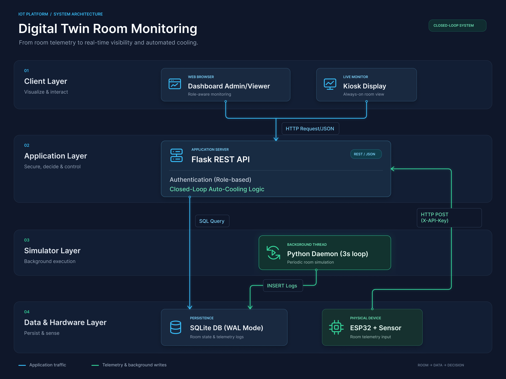

# 🏗️ ARSITEKTUR SISTEM — Digital Twin Monitoring Ruangan

Dokumentasi ini merinci struktur teknis (*technical structure*) dari aplikasi **Digital Twin Monitoring Ruangan**. Arsitektur dirancang berlapis (*layered architecture*) untuk memisahkan tanggung jawab antara antarmuka, logika bisnis, dan penyimpanan data, sehingga sistem mudah dikembangkan (*scalable*) dan dipelihara.

---

---

## 🏛️ A. Lapisan Arsitektur (Layers)

Sistem ini terdiri dari empat lapisan utama yang saling terintegrasi, dibedakan berdasarkan warna pada diagram:

### a. Client Layer (Frontend)
Lapisan antarmuka yang berinteraksi langsung dengan pengguna. Dibangun menggunakan **HTML, Tailwind CSS, dan Chart.js**.
*   **Dashboard Admin/Viewer:** Menampilkan data *real-time*, grafik historis, dan panel kontrol (khusus Admin).
*   **Kiosk Display (Public):** Tampilan *fullscreen* untuk layar monitor di depan ruangan tanpa memerlukan *login*.

### b. Application Layer (Backend)
Menggunakan **Python (Flask)** sebagai pusat kendali (REST API).
*   **Autentikasi & Otorisasi:** Mengelola sesi *login* dengan pembatasan hak akses (Admin vs Viewer).
*   **Logika Closed-Loop (Auto-Cooling):** Mengevaluasi data sensor secara otomatis dan memutuskan kapan AC harus menyala/mati berdasarkan *threshold*.
*   **API Endpoint:** Menyediakan *endpoint* `/api/sensor` untuk menerima data dari perangkat keras.

### c. Simulator Layer (Background Thread)
Sebuah *daemon thread* berjalan di latar belakang (menggunakan *library* `threading` Python).
*   Berfungsi sebagai **Dummy Generator** yang mensimulasikan data fisika ruangan setiap **3 detik** (suhu, kelembapan, okupansi) jika perangkat keras (ESP32) tidak terpasang.
*   Memastikan aplikasi tetap bisa didemonstrasikan tanpa biaya *hardware* (*Zero Budget*).

### d. Data & Hardware Layer
*   **Database Layer:** Menggunakan **SQLite (Mode WAL)** untuk performa baca/tulis yang cepat (*concurrent read/write*).
*   **Hardware Layer (Future-ready):** Integrasi **ESP32 + Sensor** melalui protokol HTTP POST dengan autentikasi `X-API-Key`.

---

## 🔗 B. Jalur Komunikasi Antar Lapisan

| Dari | Ke | Protokol | Keterangan |
|------|----|----------|------------|
| Browser (Frontend) | Flask Backend | `HTTP/REST API` | *Request* halaman web dan data JSON (*polling* telemetri). |
| Flask Backend | SQLite Database | `SQL Query` | Operasi CRUD (Tambah room, Update threshold, Baca logs). |
| ESP32 (Hardware) | Flask Backend | `HTTP POST` | *Endpoint* `/api/sensor` (Membutuhkan `X-API-Key`). |
| Simulator Thread | SQLite Database | *Internal Python* | Menyisipkan log data simulasi setiap 3 detik. |

---

## 📌 C. Kesimpulan Tahap Arsitektur

Arsitektur ini menerapkan pola **client-server berlapis** yang modern. Pemisahan *Simulator Layer* memungkinkan pengujian sistem tanpa ketergantungan perangkat fisik (*Zero Budget*), namun tetap mempertahankan *Application Layer* yang siap menerima data dari *Hardware Layer* (ESP32). Penggunaan **SQLite Mode WAL** memastikan sistem tetap responsif meskipun *background simulator* terus-menerus menulis data ke database.
