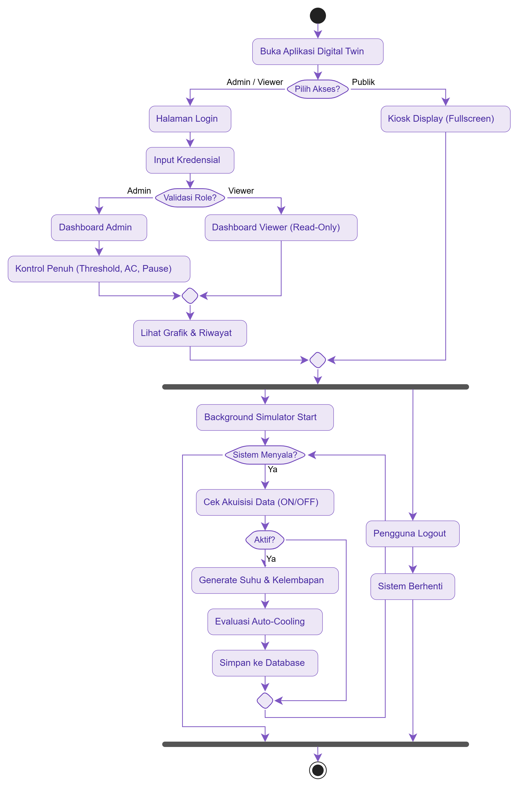

# 🔄 FLOWCHART SISTEM — Digital Twin Monitoring

Dokumentasi alur logika (*business logic*) dari aplikasi Digital Twin. Flowchart ini terbagi menjadi dua bagian besar: **Alur Interaksi Pengguna** (User Flow) dan **Perputaran Sistem Otomatis** (System Loop).

---

---

## 🧩 A. Simbol dan Kode Warna (Legenda)
*   **Terminator (Start/End):** Titik awal atau akhir dari sebuah alur.
*   **Decision (Belah Ketupat):** Percabangan kondisi (misal: cek *role*, cek status aktif).
*   **Process (Kotak):** Aktivitas yang dilakukan oleh pengguna atau sistem.
*   **Database (Silinder):** Proses penyimpanan atau pengambilan data.

---

## 🔐 B. Alur Interaksi Pengguna (User Flow)
1. **Autentikasi & Role:** Pengguna membuka web. Sistem mengecek apakah pengguna adalah **Admin** (akses penuh) atau **Viewer** (hanya melihat). Pengguna publik bisa langsung mengakses **Kiosk Display** tanpa *login*.
2. **Kontrol Admin:** Jika Admin, pengguna dapat mengakses panel kontrol untuk menekan tombol **Pause/Resume Akuisisi**, mengubah **Threshold** (Suhu ON/OFF/Alert), memicu **Trigger Alert** (simulasi panas), dan **Export CSV**.
3. **Monitoring:** Baik Admin maupun Viewer dapat memantau grafik *real-time* dan riwayat data.

---

## ⚙️ C. Alur Background Simulator (System Flow)
1. **Looping 3 Detik:** Selama sistem menyala (`acquisition_enabled == 1`), *thread background* akan membuat siklus simulasi baru setiap 3 detik.
2. **Generate Data:** Sistem membuat angka acak (namun realistis) untuk Suhu dan Kelembapan berdasarkan kapasitas ruangan dan jumlah okupansi.
3. **Evaluasi Auto-Cooling:** Data baru dibandingkan dengan *threshold*. Jika suhu melewati `temp_on`, AC menyala (`ac_state = 1`). Jika turun di bawah `temp_off`, AC mati.
4. **Pembersihan Log:** Sistem menyimpan data ke `sensor_logs`, dan otomatis menghapus log lama jika jumlahnya melebihi 1500 baris per ruangan agar *database* tidak membengkak.

---

## 📌 D. Kesimpulan Tahap Flowchart

Flowchart ini menegaskan bahwa aplikasi tidak hanya bersifat pasif (menampilkan data), tetapi juga aktif (melakukan evaluasi *Closed-Loop Auto-Cooling*). Desain alur yang memisahkan *User Interaction* dan *Background Simulation* memastikan aplikasi tetap berjalan lancar meskipun tidak ada pengguna yang sedang membuka halaman web.
