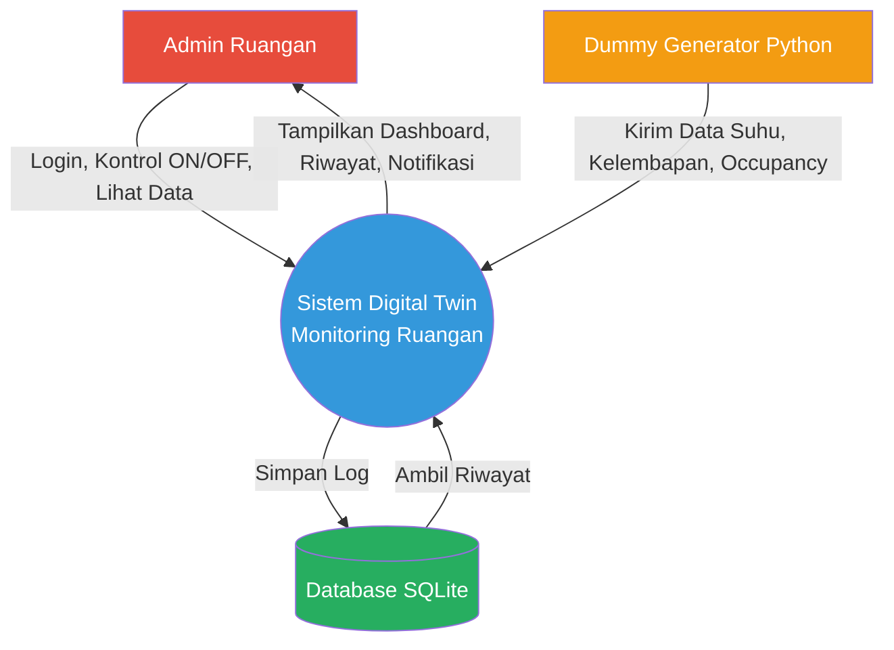
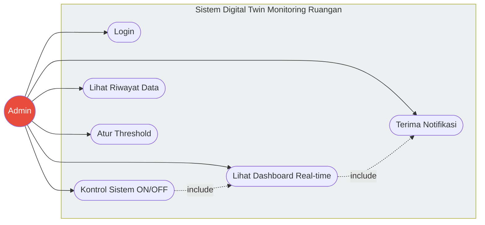
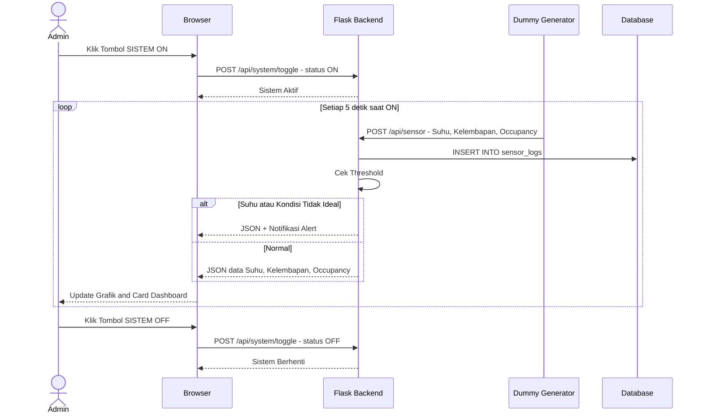
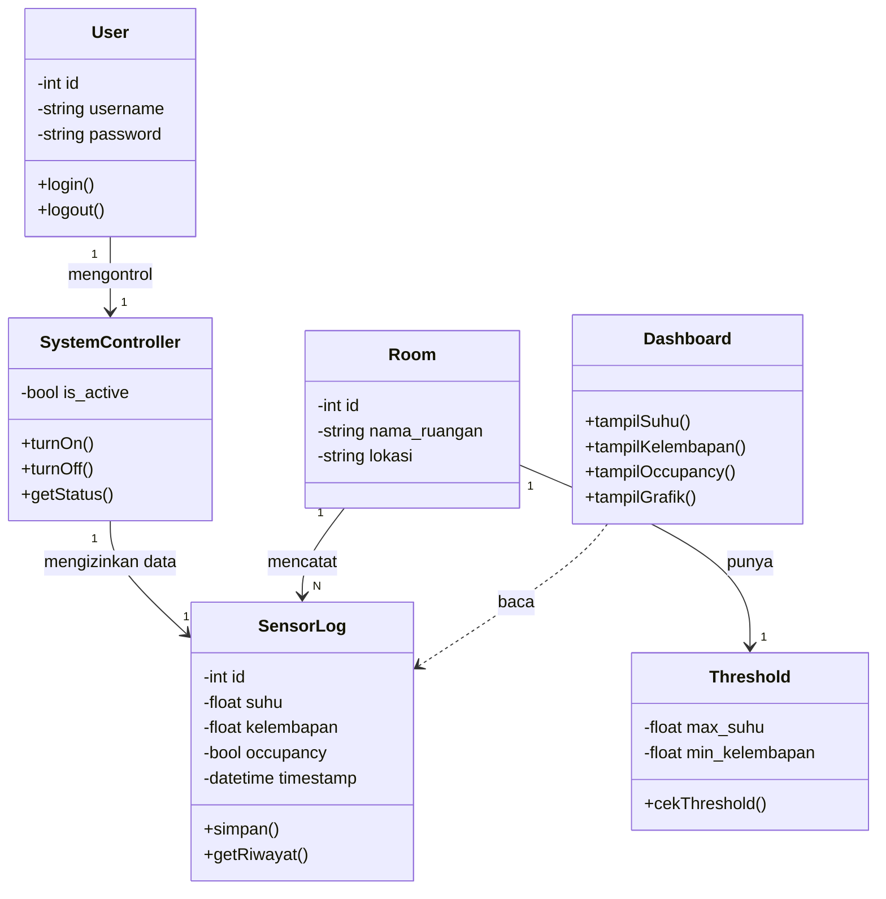
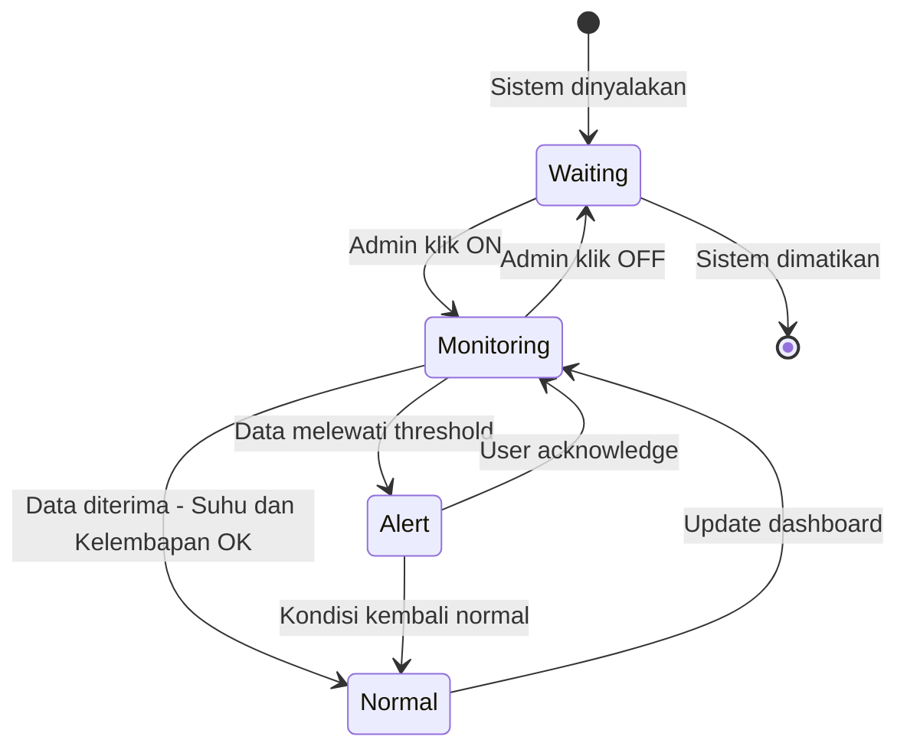

# 📊 Dokumentasi Perancangan Sistem — Digital Twin Monitoring Ruangan

Dokumentasi ini merinci pemodelan sistem fungsional dan struktural berdasarkan **Product Backlog (Sprint 1)**. Sistem ini dirancang *Zero Budget* (tanpa biaya hardware) menggunakan simulasi data.

---

## 1. Context Diagram (Batasan & Aliran Data Sistem)

### 🔑 Penjelasan & Cara Kerja
- **Admin** berinteraksi untuk login, menyalakan/mematikan sistem (On/Off), dan melihat data.
- **Dummy Generator** mensimulasikan pembacaan sensor (Suhu, Kelembapan, Occupancy) tanpa perlu hardware fisik.
- **Database SQLite** menyimpan histori data untuk ditampilkan di grafik.

---

## 2. Use Case Diagram (Interaksi Pengguna dengan Sistem)

### 🔑 Penjelasan & Cara Kerja
- **UC-02 Kontrol Sistem ON/OFF:** Fitur tambahan untuk memulai atau menghentikan simulasi data sensor.
- **UC-03 & UC-06:** Saat dashboard dinyalakan, admin melihat data Suhu, Kelembapan, dan Occupancy (Sesuai Sprint 1). Jika melewati threshold, notifikasi muncul.

---

## 3. Sequence Diagram (Alur Proses: Admin Menyalakan Sistem & Melihat Dashboard)

### 🔑 Penjelasan & Cara Kerja
Alur ini menunjukkan tombol ON memicu sistem untuk menerima data dari Dummy Generator secara berkala. Jika tombol OFF diklik, aliran data berhenti.

---

## 4. Class Diagram & Struktur Class (Struktur Statis Sistem)

### 🔑 Penjelasan & Cara Kerja
- **SystemController:** Class baru untuk mengatur status ON/OFF website.
- **SensorLog:** Mencatat 3 variabel utama dari Sprint 1: `suhu`, `kelembapan`, dan `occupancy`.
- **Dashboard:** Menampilkan ketiga variabel tersebut.

---

## 5. State Diagram (Perubahan Perilaku Sistem)

### 🔑 Penjelasan & Cara Kerja
Sistem memiliki state `Waiting` saat menunggu di-ON-kan. Saat tombol ON ditekan, ia masuk ke `Monitoring`. Dari sana ia bisa berubah ke `Normal` atau `Alert` tergantung data sensor.

---

## 6. Framework & Tech Stack (Zero Budget)

Sesuai kesepakatan, proyek ini **tidak memerlukan biaya sepeser pun (Rp 0)**.

| Komponen | Teknologi | Biaya |
|----------|-----------|-------|
| Backend | Python (Flask) | Gratis |
| Database | SQLite | Gratis |
| Frontend | HTML, Tailwind CSS (CDN), Chart.js | Gratis |
| Simulasi Data | Python `random` & `time` | Gratis |
| Hosting | Localhost / GitHub Pages / Render | Gratis |
