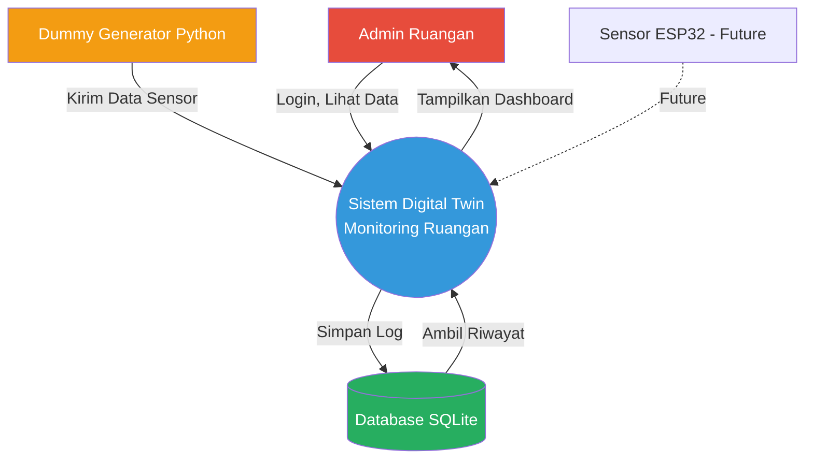
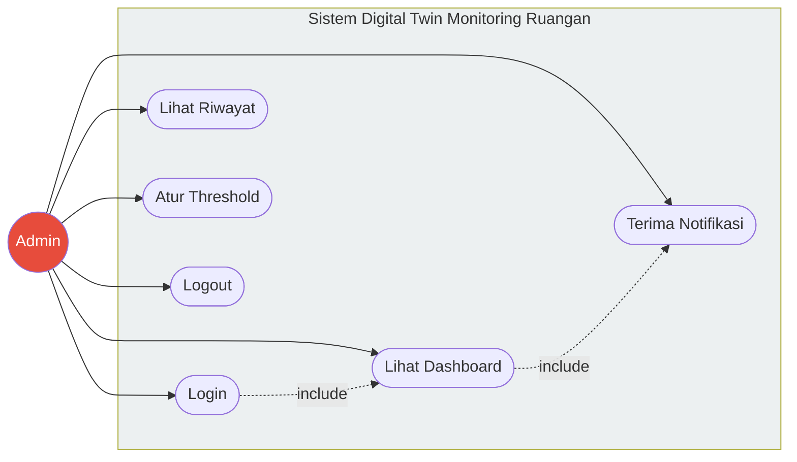
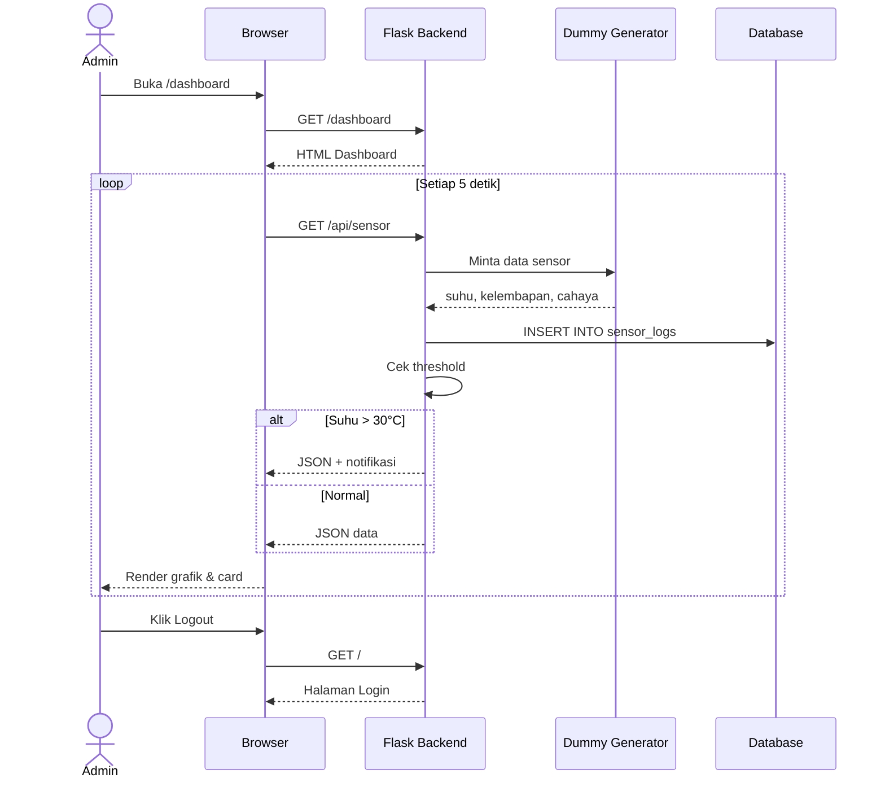
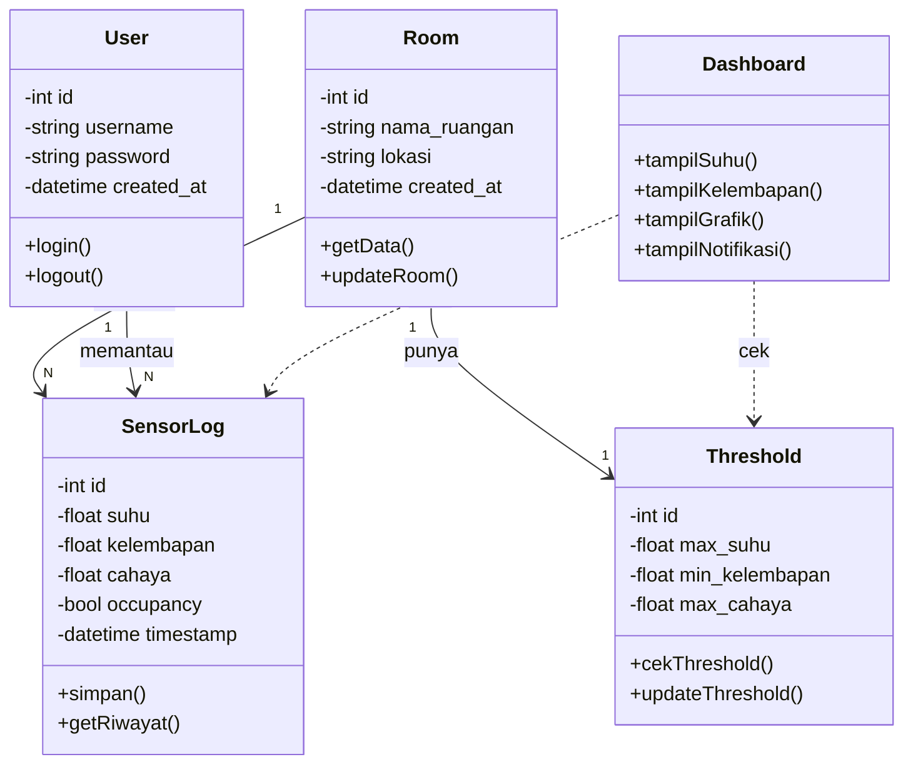
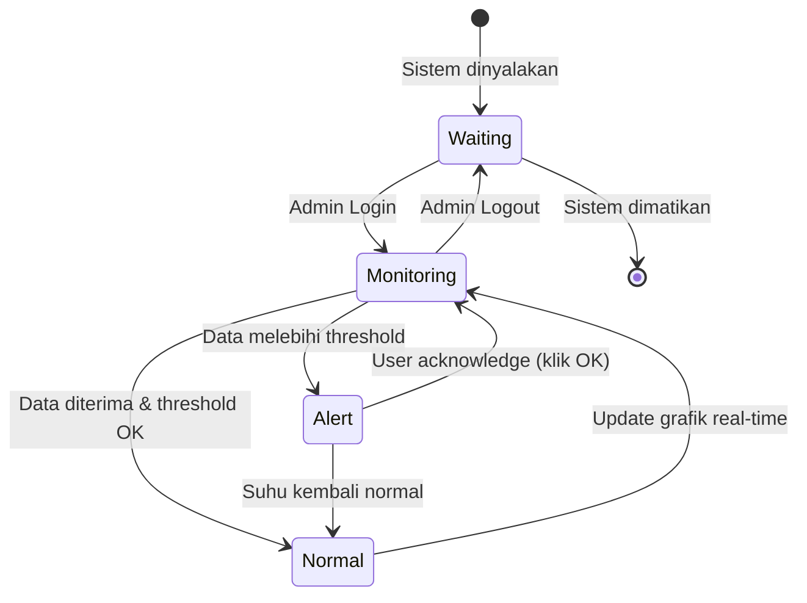

# 📊 Dokumentasi Perancangan Sistem — Digital Twin Monitoring Ruangan

Dokumentasi ini merinci pemodelan sistem fungsional dan struktural dari platform **Digital Twin Monitoring Ruangan** yang dibangun berdasarkan pendekatan *Object-Oriented Analysis and Design (OOAD)*.

---

## 1. Context Diagram (Batasan & Aliran Data Sistem)

### 🔑 Penjelasan & Cara Kerja

Diagram ini memandang sistem **Digital Twin Monitoring Ruangan** sebagai satu kesatuan proses tunggal yang berinteraksi dengan entitas luar:

- **Admin → Sistem:** Mengirimkan data login, meminta data sensor, dan melihat riwayat. Sistem membalas dengan menampilkan dashboard, grafik, dan notifikasi.
- **Dummy Generator → Sistem:** Mengirimkan data sensor (suhu, kelembapan, cahaya) setiap 5 detik sebagai simulasi.
- **Database → Sistem:** Menyimpan log sensor dan melayani permintaan riwayat data.
- **Sensor ESP32 (Future):** Rencana integrasi hardware asli pada pengembangan berikutnya.

### 🎯 Batas Sistem
- **Termasuk:** Login, dashboard, riwayat, threshold, notifikasi
- **Tidak Termasuk:** Hardware sensor asli, kontrol perangkat fisik, multi-user kompleks

---

## 2. Use Case Diagram (Interaksi Pengguna dengan Sistem)

### 🔑 Penjelasan & Cara Kerja

- **Admin:** Memiliki akses penuh untuk login, melihat dashboard real-time, melihat riwayat data, mengatur ambang batas, dan menerima notifikasi.
- **Relasi Khusus (`<<include>>`):** Proses *Lihat Dashboard* wajib memicu proses *Terima Notifikasi* agar peringatan kondisi abnormal dapat ditampilkan.

### 📋 Detail Use Case

| ID | Use Case | Deskripsi | Prioritas |
|----|----------|-----------|-----------|
| UC-01 | Login | Masuk dengan username & password | Tinggi |
| UC-02 | Lihat Dashboard | Melihat kondisi ruangan real-time | Tinggi |
| UC-03 | Lihat Riwayat | Melihat log historis data sensor | Sedang |
| UC-04 | Atur Threshold | Mengubah ambang batas suhu/kelembapan | Sedang |
| UC-05 | Terima Notifikasi | Mendapat alert jika kondisi abnormal | Tinggi |
| UC-06 | Logout | Keluar dari sistem | Rendah |

---

## 3. Sequence Diagram (Alur Proses: Admin Melihat Dashboard)

### 🔑 Penjelasan & Cara Kerja

- **Admin → Browser:** Membuka halaman dashboard.
- **Browser → Flask:** Meminta HTML dashboard.
- **Loop setiap 5 detik:** Browser meminta data sensor terbaru.
- **Flask → Generator:** Mengambil data suhu, kelembapan, cahaya dari simulasi.
- **Flask → Database:** Menyimpan log sensor.
- **Flask → Flask:** Cek threshold.
- **Kondisi (alt):**
  - Jika suhu > 30°C → kirim notifikasi merah
  - Jika normal → kirim data grafik
- **Logout:** Admin keluar, browser kembali ke halaman login.

### 📋 Skenario

| Aspek | Keterangan |
|-------|-----------|
| Nama | Melihat Dashboard Real-time |
| Aktor | Admin |
| Precondition | Admin sudah login |
| Postcondition | Data sensor tampil di dashboard |

---

## 4. Class Diagram & Struktur Class (Struktur Statis Sistem)

### 🔑 Penjelasan & Cara Kerja

- **User:** Merepresentasikan admin sistem dengan atribut login dan operasi autentikasi.
- **Room:** Merepresentasikan ruangan yang dimonitor, memiliki data lokasi dan operasi pengambilan data.
- **Threshold:** Menyimpan ambang batas kondisi ideal ruangan (suhu, kelembapan, cahaya).
- **SensorLog:** Mencatat semua data sensor yang masuk beserta timestamp.
- **Dashboard:** Class antarmuka yang menampilkan data ke pengguna.

### 📋 Relasi Antar Class

| Relasi | Tipe | Multiplicity | Keterangan |
|--------|------|--------------|-----------|
| Room → Threshold | Composition | 1 : 1 | 1 ruangan punya 1 threshold |
| Room → SensorLog | Aggregation | 1 : N | 1 ruangan punya banyak log |
| User → SensorLog | Association | 1 : N | 1 user memantau banyak log |
| Dashboard → SensorLog | Dependency | - | Dashboard membaca data log |
| Dashboard → Threshold | Dependency | - | Dashboard cek ambang batas |

### 🔣 Simbol Multiplicity

| Simbol | Arti |
|--------|------|
| `1` | Tepat satu |
| `0..1` | Nol atau satu |
| `1..*` | Satu atau lebih |
| `*` | Nol atau lebih |

---

## 📚 Referensi

1. Sommerville, I. (2016). *Software Engineering* (10th ed.). Chapter 5: System Modeling. Pearson.
2. OMG UML Specification 2.5.1. https://www.omg.org/spec/UML/
3. Pressman, R. S. (2001). *Software Engineering: A Practitioner's Approach* (5th ed.). McGraw-Hill.

---

**Sprint 2 — System Modeling**  
**Digital Twin Monitoring Ruangan**  
**Universitas Samudra — Informatika**
---

## 5. State Diagram (Perubahan Perilaku Sistem)

### 🔑 Penjelasan & Cara Kerja
Diagram ini menunjukkan transisi status sistem. Saat sistem menyala, ia berada di status `Waiting`. Saat Admin login, ia masuk ke `Monitoring`. Jika data dari generator melebihi threshold, status berubah menjadi `Alert` (memunculkan notifikasi), dan kembali ke `Normal` jika kondisi sudah membaik.

---
