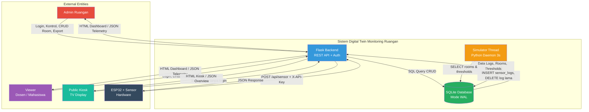
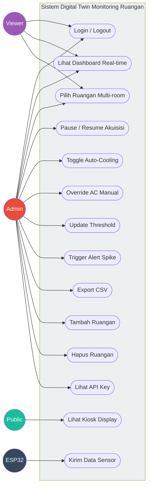
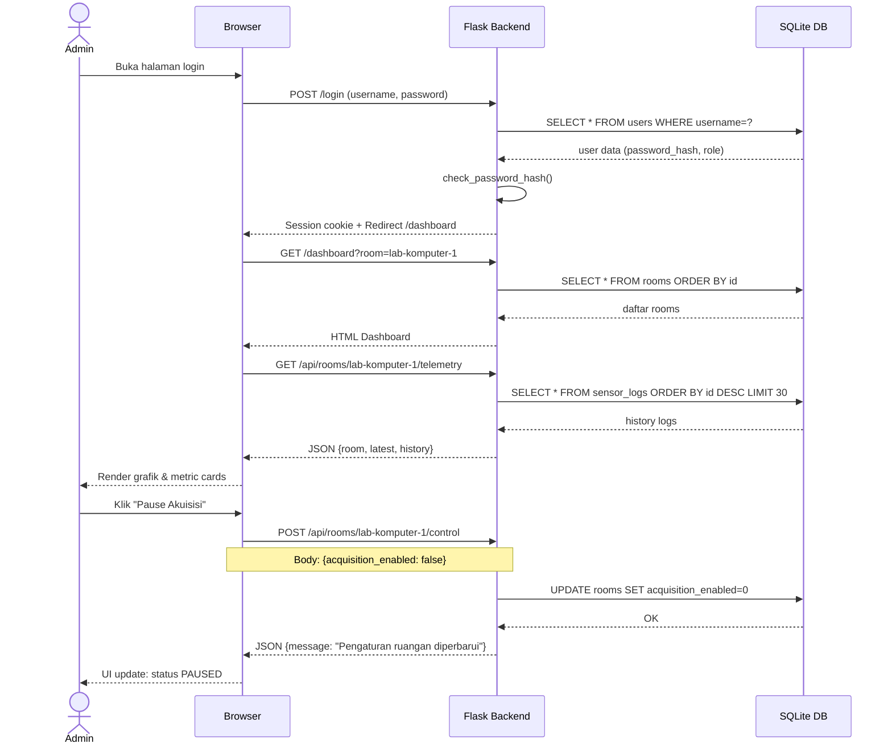
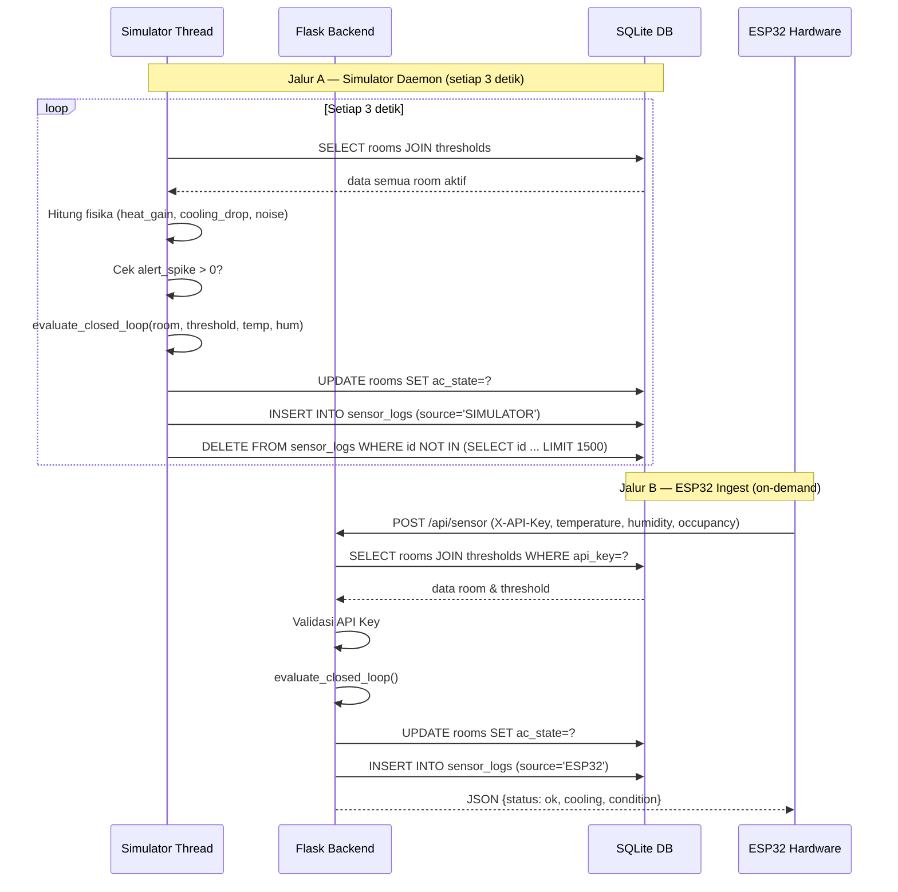
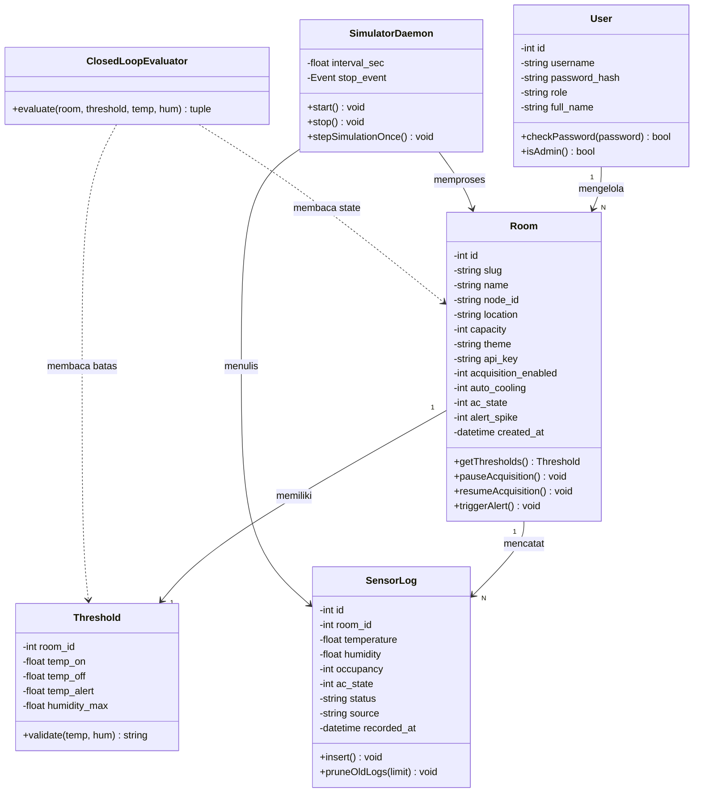
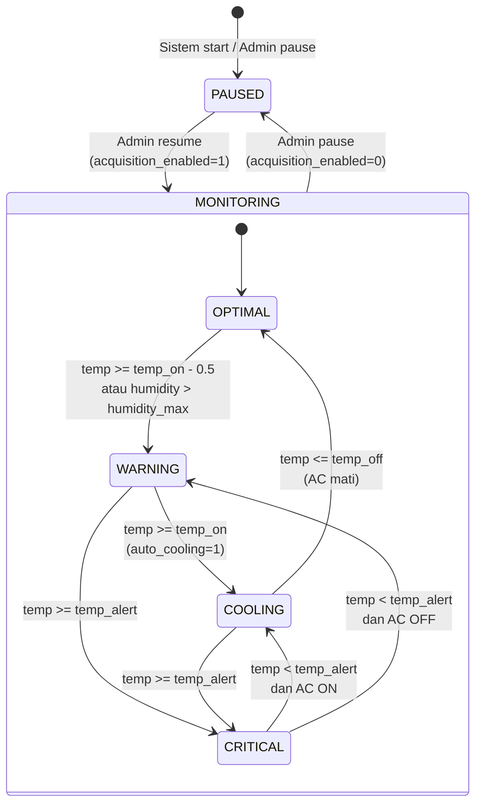

# 📊 Analisis Sistem — Digital Twin Monitoring Ruangan

Dokumentasi ini merinci pemodelan sistem fungsional dan struktural untuk aplikasi **Digital Twin Monitoring Ruangan** berbasis **Flask + SQLite**. Analisis disusun selaras dengan implementasi Sprint 3: **multi-room**, **role-based access** (Admin/Viewer/Public), **closed-loop auto-cooling**, **background simulator 3 detik**, dan **integrasi ESP32 via API Key**.

---

## 1. Context Diagram (Batasan & Aliran Data Sistem)

### 🔑 Penjelasan & Cara Kerja
- **Admin** memiliki akses penuh: login, memilih ruangan, pause/resume akuisisi, toggle auto-cooling, override AC manual, mengubah threshold, memicu trigger alert, export CSV, serta menambah/menghapus ruangan.
- **Viewer** hanya dapat login dan melihat dashboard serta riwayat data (read-only).
- **Public Kiosk** membuka `/kiosk` tanpa login untuk ditampilkan di layar TV depan ruangan.
- **ESP32** mengirim data sensor melalui `POST /api/sensor` dengan header `X-API-Key` (opsional, karena simulator juga berjalan).
- **Simulator Thread** berjalan di latar belakang setiap 3 detik, menulis langsung ke SQLite (bukan via HTTP), dan mengevaluasi logika closed-loop.
- **SQLite** menyimpan seluruh konfigurasi ruangan, threshold, dan histori log sensor (maksimal 1500 baris per ruangan).

---

## 2. Use Case Diagram (Interaksi Pengguna dengan Sistem)

### 📋 Tabel Use Case & Hak Akses

| Kode | Use Case | Admin | Viewer | Public | ESP32 |
|------|----------|:-----:|:------:|:------:|:-----:|
| UC-01 | Login / Logout | ✅ | ✅ | ❌ | ❌ |
| UC-02 | Lihat Dashboard Real-time | ✅ | ✅ | ❌ | ❌ |
| UC-03 | Pilih Ruangan Multi-room | ✅ | ✅ | ✅ | ❌ |
| UC-04 | Pause / Resume Akuisisi | ✅ | ❌ | ❌ | ❌ |
| UC-05 | Toggle Auto-Cooling | ✅ | ❌ | ❌ | ❌ |
| UC-06 | Override AC Manual | ✅ | ❌ | ❌ | ❌ |
| UC-07 | Update Threshold | ✅ | ❌ | ❌ | ❌ |
| UC-08 | Trigger Alert Spike | ✅ | ❌ | ❌ | ❌ |
| UC-09 | Export CSV | ✅ | ❌ | ❌ | ❌ |
| UC-10 | Tambah Ruangan | ✅ | ❌ | ❌ | ❌ |
| UC-11 | Hapus Ruangan | ✅ | ❌ | ❌ | ❌ |
| UC-12 | Lihat API Key | ✅ | ❌ | ❌ | ❌ |
| UC-13 | Lihat Kiosk Display | ❌ | ❌ | ✅ | ❌ |
| UC-14 | Kirim Data Sensor | ❌ | ❌ | ❌ | ✅ |

### 🔑 Penjelasan & Cara Kerja
- **UC-04 s/d UC-08** semuanya diakses melalui satu endpoint `POST /api/rooms/<slug>/control`.
- **UC-09** menggunakan endpoint `GET /api/rooms/<slug>/export.csv` (maksimal 500 log terakhir).
- **UC-10 & UC-11** hanya bisa dilakukan Admin; sistem menolak hapus jika tersisa 1 ruangan.
- **UC-12** API Key hanya ditampilkan kepada Admin (Viewer tidak menerima field `api_key` di response JSON).
- **UC-13** Kiosk bersifat publik tanpa autentikasi, mengambil data dari `/api/public/overview`.
- **UC-14** ESP32 mengirim data ke `/api/sensor` dengan header `X-API-Key`; jika tidak valid, ditolak 403.

---

## 3. Sequence Diagram (Alur Proses Utama)

### 3a. Alur Kontrol Admin (Login → Pilih Room → Kontrol)

### 3b. Alur Background Simulator & ESP32 Ingest (Dua Jalur Paralel)

### 🔑 Penjelasan & Cara Kerja
- **Jalur A (Simulator)**: Berjalan otomatis di *daemon thread* setiap 3 detik. Simulator **menulis langsung** ke SQLite tanpa melalui HTTP, sehingga hemat resource dan tidak memerlukan autentikasi. Data retention 1500 baris per ruangan dijaga agar database tidak membengkak.
- **Jalur B (ESP32)**: Hanya aktif jika perangkat keras terpasang. Data masuk melalui `POST /api/sensor` dengan header `X-API-Key` yang harus cocok dengan `rooms.api_key`. Flask tetap menjalankan `evaluate_closed_loop()` sebelum menyimpan log ber-`source='ESP32'`.
- **Keduanya bisa berjalan bersamaan**; kolom `source` pada `sensor_logs` membedakan asal data.

---

## 4. Class Diagram & Struktur Class (Struktur Statis Sistem)

### 🔑 Penjelasan & Cara Kerja
- **User**: `password_hash` (bukan plain text), `role` menentukan hak akses. Method `checkPassword()` memakai `werkzeug.security.check_password_hash`.
- **Room**: Menyimpan seluruh konfigurasi ruangan termasuk `theme` (mempengaruhi model fisika), `api_key` (untuk ESP32), dan state kontrol (`acquisition_enabled`, `auto_cooling`, `ac_state`, `alert_spike`).
- **Threshold**: Satu ruangan tepat satu threshold (`1:1`). `temp_on`/`temp_off` untuk histeresis AC, `temp_alert` untuk status CRITICAL, `humidity_max` untuk batas kelembapan.
- **SensorLog**: Menyimpan `status` (OPTIMAL/WARNING/COOLING/CRITICAL) dan `source` (SIMULATOR/ESP32). Method `pruneOldLogs()` menjaga maksimal 1500 baris per ruangan.
- **SimulatorDaemon**: Mengelola *background thread* dengan `threading.Event` untuk graceful shutdown. Method `stepSimulationOnce()` menjalankan satu siklus fisika.
- **ClosedLoopEvaluator**: Fungsi murni (`pure function`) yang mengevaluasi logika auto-cooling berdasarkan `auto_cooling`, `ac_state`, dan threshold.

---

## 5. State Diagram (Perubahan Perilaku Sistem)

### 📋 Tabel Transisi State

| State Asal | State Tujuan | Pemicu | Aksi Sistem |
|---|---|---|---|
| PAUSED | MONITORING | Admin klik Resume | `UPDATE rooms SET acquisition_enabled=1` |
| MONITORING | PAUSED | Admin klik Pause | `UPDATE rooms SET acquisition_enabled=0` |
| OPTIMAL | WARNING | `temp >= temp_on - 0.5` atau `humidity > humidity_max` | Log status WARNING |
| WARNING | COOLING | `temp >= temp_on` dan `auto_cooling=1` | `ac_state=1`, log status COOLING |
| COOLING | OPTIMAL | `temp <= temp_off` | `ac_state=0`, log status OPTIMAL |
| WARNING / COOLING | CRITICAL | `temp >= temp_alert` | Log status CRITICAL, trigger visual alert |
| CRITICAL | WARNING / COOLING | `temp < temp_alert` | Kembali ke state sesuai kondisi AC |

### 🔑 Penjelasan & Cara Kerja
- **PAUSED**: Akuisisi dihentikan sementara. Simulator melewati ruangan ini (`if acquisition_enabled != 1: continue`).
- **MONITORING** adalah *composite state* yang berisi empat sub-state kondisi ruangan.
- Transisi antar sub-state dievaluasi oleh `evaluate_closed_loop()` setiap siklus 3 detik (atau saat ESP32 mengirim data).
- **Alert Spike** memaksa suhu naik mendekati `temp_alert` selama 4 siklus, sehingga state berubah ke CRITICAL secara terkendali untuk demonstrasi.

---

## 6. Framework & Tech Stack (Zero Budget)

| Komponen | Teknologi | Fungsi | Biaya |
|----------|-----------|--------|-------|
| Backend | Python 3 + Flask | REST API, routing, session | Gratis |
| Auth | Werkzeug Security | Hash password (`generate_password_hash`) | Gratis |
| Database | SQLite (Mode WAL) | Penyimpanan konfigurasi & log time-series | Gratis |
| Frontend | HTML, Tailwind CSS (CDN) | Layout dashboard & kiosk | Gratis |
| Grafik | Chart.js (CDN) | Line chart real-time 30 data terakhir | Gratis |
| Simulasi | Python `threading`, `random`, `math` | Daemon simulator 3 detik | Gratis |
| Export | Python `csv` + `io.StringIO` | Export 500 log terakhir | Gratis |
| Hardware (opsional) | ESP32 + Sensor DHT | Ingest via `/api/sensor` | Tidak wajib |
| Hosting | Localhost / Render / Railway | Deployment Flask | Gratis (tier) |

### 🔑 Penjelasan & Cara Kerja
- Proyek **tidak memerlukan biaya hardware** karena simulator bawaan sudah mensimulasikan data fisika ruangan secara realistis (`heat_gain`, `cooling_drop`, `occupancy drift`).
- **SQLite Mode WAL** dipilih agar simulasi tulis dan pembacaan dashboard tidak saling mengunci.
- **GitHub Pages tidak digunakan** untuk backend Flask karena Flask membutuhkan *runtime* Python; hosting yang direkomendasikan adalah Render/Railway atau localhost.
- Semua library bersifat *zero-install* via CDN (Tailwind, Chart.js), sementara backend hanya membutuhkan `Flask`.

---

## 📌 7. Kesimpulan Analisis Sistem

| Aspek | Hasil Analisis |
|---|---|
| **Aktor** | 4 entitas: Admin, Viewer, Public Kiosk, ESP32 |
| **Role-based access** | Diterapkan di level endpoint (`@login_required`, `@admin_required`) |
| **Multi-room** | Didukung via `slug` unik dan `node_id` per ruangan |
| **Real-time** | Polling JSON `/telemetry` + simulator daemon 3 detik |
| **Kontrol** | Satu endpoint `control` untuk pause, auto-cooling, override AC, threshold, alert |
| **Hardware-ready** | Endpoint `/api/sensor` siap menerima ESP32 dengan `X-API-Key` |
| **Zero Budget** | Simulator menjadi fallback tanpa hardware fisik |
| **Data retention** | Otomatis *prune* log > 1500 baris per ruangan |

Analisis ini menjadi dasar bagi diagram pendukung lainnya (`02-activity-diagram.png`, Object Diagram, Deployment Diagram) dan konsisten dengan implementasi Sprint 3 pada `app.py`, `schema.sql`, dan `simulator.py`.
